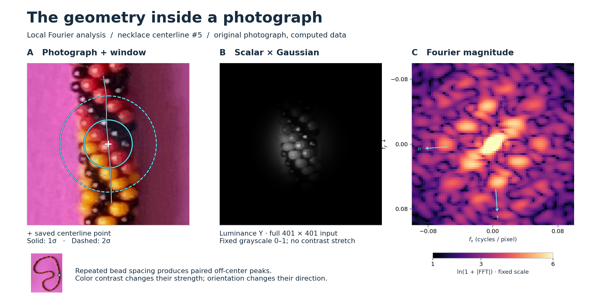
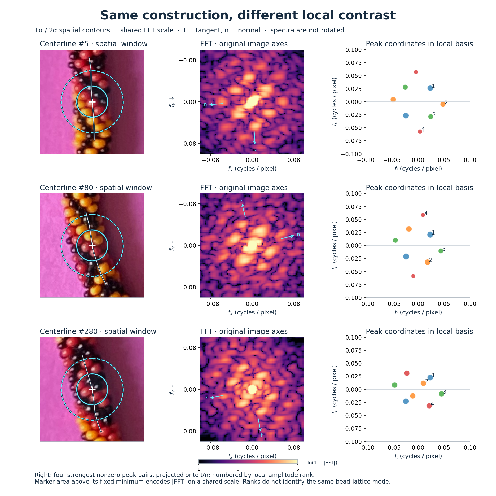

# FFT Image Explorer

Interactive 2D FFT explorer for color images.

This project shows an image in both the spatial and frequency domains so you can see how masks, soft edges, and frequency filters change what remains. It is especially useful for comparing smooth background regions against texture, repeating patterns, and edge-heavy foreground objects.



On the right side of the necklace (saved centerline point 5), the cyan circles mark one and two standard deviations of a **spatial Gaussian window**. The middle panel shows the actual scalar luminance input multiplied by that window; the right panel shows its computed 2D Fourier magnitude on a logarithmic scale. Repeated bead spacings produce recognizable off-center peak pairs and directional structure. This is a generated scientific figure from the original photograph, not an application screenshot.

[Generation details and numerical conventions](docs/fft-figures.md) · [Three candidate figures](docs/figures/local-fft-candidates.png)

For a compact visual introduction, the [project-card image](docs/figures/local-fft-card.png) pairs an enlarged Candidate 5 photograph with its corresponding FFT. It is composed specifically for small displays, with two large panels and minimal text; the three-panel figure above explains the full analysis. [Preview the card at 400 pixels wide](docs/figures/local-fft-card-preview.png).

## What It Helps Explain

This tool can help you answer questions like:
- whether a region is mostly smooth background or has strong texture/patterns
- how a bracelet, fabric weave, bead pattern, or printed surface differs from a flat background
- how much of an image's energy lives near the FFT center versus farther out
- how mask size, softness, and frequency filtering change the retained content
- why some regions look similar in the image but separate in frequency space

## Key Capabilities

- load an image
- choose color-derived channels such as Y, RGB, HSV, opponent channels, and PCA components
- choose and tune a spatial mask or window
- inspect the masked input, the log-magnitude FFT, and the inverse FFT
- interactively explore high-pass, low-pass, and threshold-based filtering

## Comparing local geometry



These regions contain different mixtures of yellow, red and black beads. Each FFT receives **one luminance value per pixel**, not separately classified colors. The same channel, Gaussian size and display scale are used throughout. Local orientation rotates the frequency pattern; the right column expresses selected peaks relative to the centerline tangent and normal without rotating the FFT images.

Several peak directions and spacings are approximately similar after accounting for orientation, while their relative strengths change. The red/black region also has an additional prominent low-frequency pair. Color contrast, lighting and projection matter: a stronger peak alone does not mean the bead geometry is more regular. See the [measurements and limitations](docs/fft-figures.md) for the quantitative comparison.

## Project Files

- `fft_image_explorer.py` - main interactive app
- `scan_highpass_removed_map.py` - stride FFT scanner with boundary and centerline spline tracing
- `notes.md` - project notes and algorithm details
- `requirements.txt` - Python dependencies

## Bracelet Boundary Scanner (Current Workflow)

The scanner script builds bracelet geometry in three stages on a coarse stride grid:

1. Build a metric map from local FFT analysis.
2. Trace an outer boundary spline.
3. Find and trace an inner boundary spline.
4. Build a centerline spline between inner and outer.

Detailed centerline strategy notes are documented in `notes.md` under the spline implementation section.

Typical scanner command:

```bash
~/git/fft-image-explorer/.venv/bin/python scan_highpass_removed_map.py ~/git/beads/beads-photo-2.jpg --highpass-percent 8 --metric hp_removed --display-scale near100 --near100-alpha 0.25
```

## Quick Start

From the project folder:

```bash
python fft_image_explorer.py path/to/image.jpg
```

Copy/paste launch command:

```bash
~/git/fft-image-explorer/.venv/bin/python fft_image_explorer.py ~/git/beads/beads-photo-1.jpg
```

Example with your image:

```bash
python fft_image_explorer.py ~/git/beads/beads-photo-1.jpg
```

If you are using the project virtual environment directly:

```bash
~/git/fft-image-explorer/.venv/bin/python fft_image_explorer.py ~/git/beads/beads-photo-2.jpg
```

## Dependencies

Install from requirements:

```bash
pip install -r requirements.txt
```

Optional HEIC/HEIF support:

```bash
pip install pillow-heif
```

## Setup: WSL + VS Code + Codex

### 1. Install prerequisites

- Install WSL (Ubuntu recommended)
- Install VS Code on Windows
- Install these VS Code extensions:
  - WSL
  - Python
  - GitHub Copilot
  - GitHub Copilot Chat (Codex-capable chat in VS Code)

### 2. Open the project in WSL

In a WSL terminal:

```bash
cd ~/git/fft-image-explorer
code .
```

VS Code should reopen as a WSL workspace.

### 3. Choose Python version and create a virtual environment

Check available Python versions:

```bash
which -a python3
python3 --version
```

Create a venv with your chosen interpreter. Example:

```bash
python3.10 -m venv .venv
```

Activate it:

```bash
source .venv/bin/activate
```

Install dependencies:

```bash
pip install -r requirements.txt
```

### 4. Select the interpreter in VS Code

- Open Command Palette
- Run: `Python: Select Interpreter`
- Pick `.venv/bin/python`

### 5. Run the app

```bash
python fft_image_explorer.py ~/git/beads/beads-photo-1.jpg
```

### WSL display note

- On Windows 11 with WSLg, matplotlib windows usually open automatically.
- On Windows 10, you may need an X server for GUI windows.

## Setup: macOS + VS Code + Codex

### 1. Install prerequisites

- Install VS Code
- Install Python 3.10+ (python.org installer or Homebrew)
- Install these VS Code extensions:
  - Python
  - GitHub Copilot
  - GitHub Copilot Chat (Codex-capable chat in VS Code)

If using Homebrew:

```bash
brew install python@3.12
```

### 2. Open the project

```bash
cd ~/git/fft-image-explorer
code .
```

### 3. Choose Python and create virtual environment

Check available Python versions:

```bash
which -a python3
python3 --version
```

Create a venv with the Python you want. Example:

```bash
python3.12 -m venv .venv
```

Activate it:

```bash
source .venv/bin/activate
```

Install dependencies:

```bash
pip install -r requirements.txt
```

### 4. Select the interpreter in VS Code

- Open Command Palette
- Run: `Python: Select Interpreter`
- Choose `.venv/bin/python`

### 5. Run the app

```bash
python fft_image_explorer.py ~/git/beads/beads-photo-1.jpg
```

## Using Codex in VS Code

With GitHub Copilot Chat enabled in VS Code, you can ask Codex-style prompts directly in chat, for example:
- "Add a save-screenshot button for the FFT pane"
- "Add keyboard shortcuts for mask controls"
- "Refactor channel generation into smaller functions"

## Troubleshooting

- If `ModuleNotFoundError` appears, ensure the venv is activated and dependencies are installed.
- If VS Code runs a different Python, re-run `Python: Select Interpreter`.
- If no GUI window appears, verify local GUI support (WSLg/X server on WSL, standard desktop session on macOS).

## Future Extensions

Possible next steps for this project include:
- saving presets for masks, channels, and filter settings
- adding export buttons for screenshots of the main view and popups
- drawing the active filter radius directly on the FFT image
- adding keyboard shortcuts for common controls
- supporting batch analysis across many images or regions
- comparing multiple channels side by side with linked controls
- adding a simple foreground/background scoring mode
